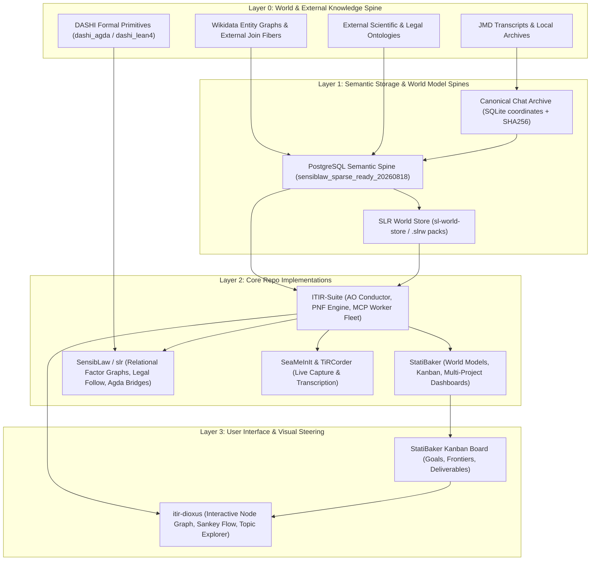

# Sublinear Topic Metasystem Architecture & Dioxus UI Specification

## 1. Executive Summary & Core Hypothesis

### The Sublinear Topic Scaling Law
As enterprise and research corpora scale from 500 to 3,000+ conversation threads, naive thread-by-thread round-robin iteration breaks down:
* **The Starvation Problem:** With thousands of threads, lower-$\alpha$ threads or niche domains are continually deferred, while thread rot and stale turn citations accumulate.
* **The Context Commons Tragedy:** Long-running "monster threads" (>500–2,000 turns) suffer catastrophic context bloat, token fatigue, and high completion latency.
* **The Sublinear Theorem:** While thread count $N$ grows rapidly, the underlying semantic topic space $\mathcal{T}(N)$ grows sublinearly:
  $$\mathcal{T}(N) \sim C \cdot N^{\gamma}, \quad \gamma < 0.5$$
  A corpus of 3,000 threads collapses into $\approx 250$–$350$ coherent primary and sub-topic manifolds, each containing 20–50 concrete implementation goals.

Rather than rotating through threads, the Autonomous Orchestrator (AO) rotates through **Topics**, using **PNF Factor Extraction** to aggregate goals across multiple threads and temporal epochs into unified project roadmaps.

---

## 2. Metasystem Topology & Cross-Project World Model



### Repo Interconnection Contracts:
1. **StatiBaker $\leftrightarrow$ Wikidata $\leftrightarrow$ Kanban:**
   * StatiBaker translates extracted PNF topic goals into interactive Kanban cards.
   * Goals are prioritized by continuous $\alpha$-projection energy and tagged with Wikidata entity bridge fibers.
2. **SensibLaw $\leftrightarrow$ `slr` $\leftrightarrow$ Formal Verification:**
   * SensibLaw maps legal and narrative controversy structures into `slr` relational frames.
   * Invariants are formally unified in `dashi_agda` and `dashi_lean4` with zero postulates.
3. **Headless `curl_cffi` Context Rejuvenation:**
   * Monster threads (>500 turns) are rejuvenated via `itir.chatgpt.revive`.
   * Rejuvenation compiles a structured memo (`<cid>_revival.md`), records parent-child lineage, and transmits via headless `curl_cffi` async transport with zero browser overhead.

---

## 3. Temporal Goal Progression across PNF Eigenspace

Within any given discovered topic manifold, concrete implementation goals do not occur in a single vacuum; they unfold across distinct conversations over time:

```
Topic Manifold: T_k [Motif: theorem · prove · dashi.physic(yangmill)]
  │
  ├── Epoch 1 (Chat 6a869945, Turn 12)  ──> Goal 1: Formulate radial flux identity
  ├── Epoch 2 (Chat 6a869945, Turn 85)  ──> Goals 2–6: Discretize boundary condition on lattice
  ├── Epoch 3 (Chat 6a86b85f, Turn 44)  ──> Goals 7–12: Connect flux identity to Max Cut operator
  └── Epoch 4 (Chat 6ac5af2d, Turn 110) ──> Goals 13–18: Unify Lean 4 and Agda AST representations
```

The PNF factor graph groups these turns by `(sentence_id, head_lemma, argument_role)`, lifting raw conversational utterances into a continuous timeline of deliverables.

---

## 4. Dynamic Conductor Cost Function & Frontier Allocation

Rather than naively spawning the maximum number of workers ($W=20$), the AO Conductor dynamically sizes worker allocations based on topic topology and frontier obstructions:

### Topic Archetypes:
1. **Frontier-Blocked Topic (e.g. 50 goals, blocked by 4 unproved lemmas):**
   * *Allocation:* Do not spawn 20 workers to churn on blocked downstream goals. Spawn exactly 4 targeted workers focused exclusively on the blocking frontier lemmas.
2. **Sequential Proof Topic (e.g. 30 goals, serial dependency chain):**
   * *Allocation:* Spawn exactly 1 worker. Parallelism would produce race conditions or invalid merge conflicts.
3. **High-Parallelism Integration Topic (e.g. 40 goals, independent module adapters):**
   * *Allocation:* Compute the sub-eigen spectrum of the 40 goals. If Marchenko-Pastur indicates 5 independent sub-eigen modes, spawn 5 workers across the 5 orthogonal clusters.

### Formal Allocation Cost Function:
$$\mathcal{C}(T_k, W) = \alpha(T_k) \cdot \frac{\text{UnblockedGoals}(T_k)}{\text{TotalGoals}(T_k)} \cdot \min\left(W_{\text{cap}}, \dim(\text{SubEigens}(T_k))\right) - \text{TokenCost}(W)$$

---

## 5. `itir-dioxus` UI Architecture Specification

In `itir-dioxus`, the user interface enables visual exploration and interactive orchestration:

### 1. Topic Explorer & Deliverables Drill-Down:
* **Level 1 (Topic Manifold):** Displays the sublinear topic landscape (e.g. 30–300 topics) styled with discriminative PNF frame motifs and continuous $\alpha$ priority badges.
* **Level 2 (Topic Goals):** Clicking a topic expands its 20–50 constituent goals derived across the chat timeline.
* **Level 3 (Deliverables & PR Lineage):** Shows exact commit hashes, formal Agda/Lean proofs, and associated GitHub PRs.

### 2. Multi-Project Drag-and-Drop Node Graph:
* Visual canvas where nodes represent topic clusters across repositories (`ITIR-suite`, `SensibLaw`, `StatiBaker`, `SeaMeInIt`).
* Users can drag connection edges between disparate project nodes (e.g. joining a SensibLaw parser node with a StatiBaker Kanban view), establishing a governed bridge receipt.

### 3. Multi-Metric Sankey Flow:
* Interactive Sankey diagram visualizing the flow from raw chats $\to$ PNF factor clusters $\to$ active worker lanes $\to$ verified commits.
* **Metric Selector:** Toggle flow widths and color intensities by:
  1. **Continuous $\alpha$ (Spectral Energy)**
  2. **Perplexity / Uncertainty Gradient**
  3. **Frontier Blockage Count**
  4. **Task Priority / Business Urgency**

---

## 6. Governed Prompt Presets

All worker prompt presets (`@max_cut`, `@grug_ste100`, `@zkp_qa`, `@introspective_viz`, `@converge_toe`, `@referee_pass`) in `itir-mcp` and `reverse-engineered-chatgpt` enforce the in-repo formalization rule:

> *"Check dashi_lean4 and dashi_agda and formalise the current problem in terms of relevant in-repo machinery."*
