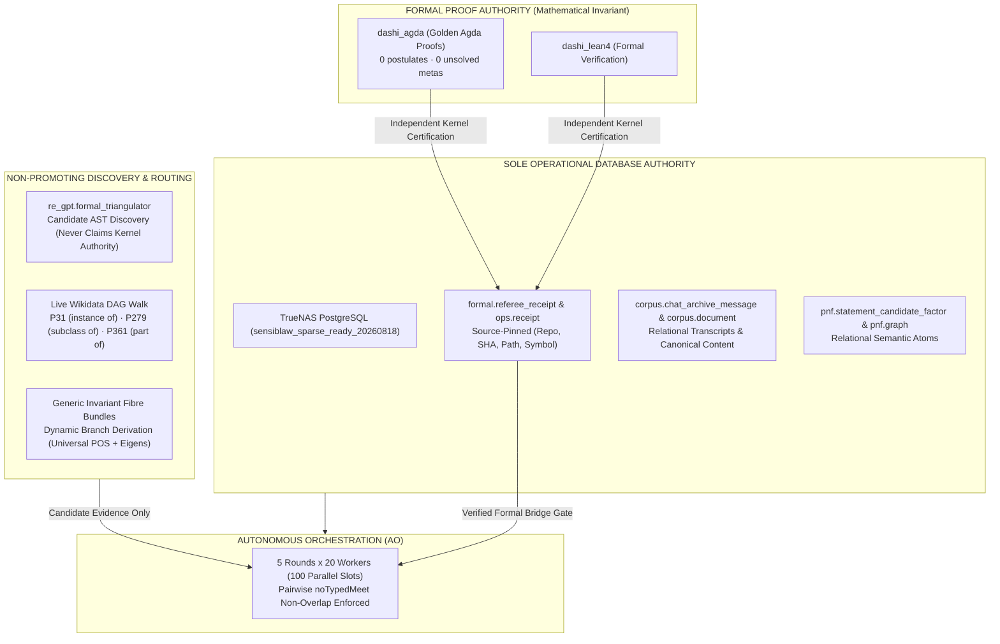
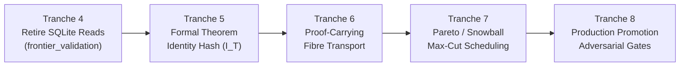

# System Handoff & Architecture Roadmap Synthesis

**Date:** 2026-10-30  
**Repository:** `ITIR-suite` (Commit: `1ec40c3`)  
**Target Cluster:** TrueNAS PostgreSQL (`sensiblaw_sparse_ready_20260818`)  
**Formal Ground Truth:** Golden Agda (`dashi_agda`, `{-# OPTIONS --safe #-}`, 0 postulates, 0 unsolved metas)  

---

## 1. Executive Summary & Epistemic Architecture

Over the recent development cycle, the system has undergone a fundamental architectural transition from ad-hoc lane-specific prototypes and transitional local stores (SQLite, `.slrw`) to an immutable, mathematically governed dual-gate architecture:

### The Inviolable Epistemic Invariant:
$$\text{Observed Candidate AST} \;\ne\; \text{Kernel Referee Receipt} \;\ne\; \text{Transportable Lemma} \;\ne\; \text{Published Theorem}$$

1. **Golden Agda** is the sole truth boundary for mathematical theoremhood.
2. **PostgreSQL** is the sole authority for operational state, receipts, and relational world models.
3. **Candidate Discovery Machinery** (AST triangulation, Wikidata crawls, spectral eigens) produces candidate discovery routes only; it never creates proof authority or bypasses kernel certification.

---

## 2. What Has Been Completed & Merged into `main`

### A. Generic-First Invariant Fibres & Live Wikidata DAG (PR #56 — Merged)
- **Purged Lane-Specific Hardcoding:** Eliminated hardcoded Yang-Mills constructors (`build_yang_mills_fibre_bundle`) and synthetic branch IDs (`ym:lattice-transfer`).
- **Dynamic Branch Derivation:** Branches are now dynamically derived via `derive_fibre_branches` from thread factor eigens and Universal POS distributions.
- **Authoritative Wikidata Truth:** Corrected Max-Cut entity ID from erroneous placeholder `Q5577665` (19th-century Swedish politician Gottfrid Björklund) to canonical Wikidata QID **`Q942557`** ("maximum cut").
- **Human-Readable Ontology Paths:** Formatted Wikidata traversal hops with English labels (`P31: instance of`, `P279: subclass of`, `P361: part of`, `P2738: disjoint union`).

### B. Sole PostgreSQL Authority & Fail-Closed Semantics (PR #57 — Merged)
- **Eliminated Runtime SLRW Fallbacks:** Removed all runtime `.slrw` file loaders from `pg_semantic_spine.py` and `spectral_plot_tools.py`.
- **Enforced Fail-Closed Outage Handling:** Under simulated PostgreSQL outages, all preferred corpus loaders immediately fail closed (`PostgresSemanticSpineUnavailable`) rather than substituting deprecated offline files.

### C. PostgreSQL Formal Referee Receipts (PR #58 — Merged)
- **Database Schema Migration:** Introduced `formal.referee_receipt` in PostgreSQL (`itir-mcp/sql/20261030_formal_referee_receipt.sql`).
- **Source-Pinned Receipts:** Receipts are cryptographically pinned to `(repository, commit_sha, file_path, symbol, checker_engine)` with replay conflict protection (`ON CONFLICT DO NOTHING`).
- **Candidate vs Kernel Separation:** `formal_triangulation_evidence.py` guarantees that triangulated ASTs are explicitly typed as unverified discovery candidates (`kernel_verified=False`, `candidate_only=True`).

### D. First-Class CDP Session Capture & Automated Token Refresh (Merged)
- **First-Class MCP Tools:**
  - `itir.chatgpt.cdp_capture` in `itir-mcp`
  - `chatgpt_cdp_capture` in `reverse-engineered-chatgpt`
- **Sub-Second WebSocket Capture:** Fast-path CDP on `http://127.0.0.1:9222` captures authenticated sessions, tokens, and cookies in $<0.5$s without heavy browser automation or DOM rendering.
- **Zero-Script Automated Maintenance:** Precommit mutation guards and `chatgpt_get_access_token` automatically trigger CDP or cookie-jar refresh when session state is stale, automatically synchronizing `~/.chatgpt_session`.

### E. Fleet Barrier Scheduling Scale-Out
- Verified 5 rounds $\times$ 20 workers ($W=20, R=5 = 100$ parallel slots) under `plan_fleet_round_barriers`.
- $100 / 100$ slots selected ($20$ per round, $0$ held) under typed AST support (`files`, `symbols`, `lemmas`) with 100% pairwise `noTypedMeet` non-overlap.

---

## 3. Test Suite Verification Baseline

| Test Target | Tests | Status | Execution Time |
| :--- | :---: | :---: | :---: |
| `tests/test_da51_slr_formal_evidence_fixture.py` & `itir-mcp/tests/` | **286** | **PASS** | 26.26s |
| `reverse-engineered-chatgpt/tests/` | **349** | **PASS** | 3.95s |
| `scripts/test_real_pillars_3_and_4.py` (Live Wikidata API + Live Agda ASTs) | **2** | **PASS** | 3.8s |
| **Total Verified Test Suite** | **635** | **PASS (100%)** | — |

---

## 4. Where We Are Going: Subsequent Implementation Tranches

Based on the 3-round collaborative synthesis with the remote MCP worker, the remaining roadmap consists of 5 sequential authority gates:

### Tranche 4 — Complete Operational PostgreSQL Authority Migration (Immediate Next Max-Cut)
- **Objective:** Eliminate the final operational reads from SQLite.
- **Scope:** Migrate completed-operation lookups and canonical thread mappings in `itir-mcp/src/itir_mcp/frontier_reference_validation.py` to PostgreSQL `ops.mutation_operation` and `corpus.chat_archive_message`.
- **Acceptance Criterion:** System functions with `~/.chatgpt_history.sqlite3` completely unmounted or deleted.

### Tranche 5 — Formal Theorem Identity & Provenance
- **Objective:** Prevent name collisions or AST fragments from impersonating verified theorems.
- **Formulation:** Cryptographic identity digest:
  $$I_T = H(\text{repo}, \text{commit}, \text{module}, \text{symbol}, \text{statement}, \text{assumptions})$$
- **Scope:** Connect $I_T$ directly to `formal.theorem_manifest` and `ops.receipt`.

### Tranche 6 — Proof-Carrying Fibre Transport
- **Objective:** Enforce that shared invariant presence does not imply proof transportability:
  $$\operatorname{SharedInvariant}(A, B) \;\not\Rightarrow\; \operatorname{TransportableProof}(A, B)$$
- **Scope:** Require explicit Agda transport witness obligations (source representation, target representation, assumptions, invariant preservation) before cross-branch projection.

### Tranche 7 — Pareto / Snowball / Ibrahim Scheduling Integration
- **Objective:** Optimize downstream proof exposure across the fleet while preserving typed independence:
  $$\max_S \left[ \operatorname{VerifiedExposure}(S) + \alpha\operatorname{Reuse}(S) + \beta\operatorname{UnblockedConsumers}(S) - \gamma\operatorname{Duplication}(S) \right]$$
  $$\text{subject to } \forall i \ne j \in S,\; \operatorname{noTypedMeet}(i, j)$$

### Tranche 8 — Production Theorem-Promotion Hardening
- **Objective:** Hardened enforcement gate against 4 adversarial vectors:
  1. Forged AST evidence (lacking kernel certificate).
  2. Stale Git commit SHAs.
  3. Conflicting referee receipts.
  4. Offline PostgreSQL database.
- **Acceptance Criterion:** All 4 vectors fail closed with deterministic non-promotion receipts.

---

## 5. Canonical Documentation Index

1. **Sole Database Directive:**  
   [`docs/architecture/SINGLE_CANONICAL_STORE_AND_PG_SPINE_ROADMAP.md`](file:///home/c/Documents/code/ITIR-suite/docs/architecture/SINGLE_CANONICAL_STORE_AND_PG_SPINE_ROADMAP.md)
2. **Actor–Discriminator Governance Doctrine:**  
   [`AGENTS.md`](file:///home/c/Documents/code/ITIR-suite/AGENTS.md)
3. **Formal Receipt Schema:**  
   [`itir-mcp/sql/20261030_formal_referee_receipt.sql`](file:///home/c/Documents/code/ITIR-suite/itir-mcp/sql/20261030_formal_referee_receipt.sql)
4. **Planning & Changelogs:**  
   - [`docs/planning/pg_formal_referee_receipts_20261030.md`](file:///home/c/Documents/code/ITIR-suite/docs/planning/pg_formal_referee_receipts_20261030.md)
   - [`docs/changelog/pg_formal_referee_receipts_20261030.md`](file:///home/c/Documents/code/ITIR-suite/docs/changelog/pg_formal_referee_receipts_20261030.md)
   - [`docs/changelog/pg_sole_semantic_authority_20261030.md`](file:///home/c/Documents/code/ITIR-suite/docs/changelog/pg_sole_semantic_authority_20261030.md)
5. **Real Pillars 3 & 4 Integration Test:**  
   [`scripts/test_real_pillars_3_and_4.py`](file:///home/c/Documents/code/ITIR-suite/scripts/test_real_pillars_3_and_4.py)
