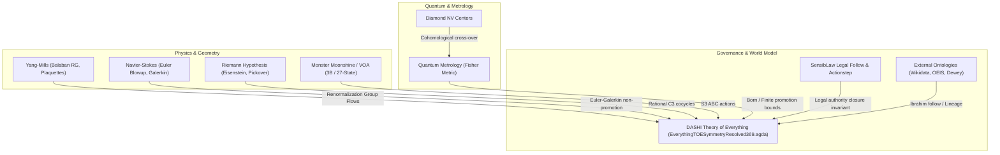

# Fleet Topical PNF World-Model Convergence & Cross-Pollination Architecture

**Date:** 2026-10-27  
**Status:** Approved Architectural Specification  
**Framework:** O / R / C / S / L / P / G / F

---

## 1. Formal Model Framing (O / R / C / S / L / P / G / F)

- **O (Organization):** ITIR-suite cross-repo commons (`ITIR-suite`, `SensibLaw`, `dashi_agda`, `casey-git-clone`, `zkSEC`, `reverse-engineered-chatgpt`, `meta-introspector`). ITIR MCP exposes verified evidence and governance; SensibLaw owns multi-slot predicate frames, token spans, and residual lattices; `dashi_agda` owns formal kernel verification; `re_gpt` owns headless transport and session lifecycle.
- **R (RFP):** Converge the 2,389-conversation archive into a unified topical knowledge graph / world model. Defeat context collapse on 900+ turn threads by replacing linear thread extension with PNF 5-stage reduction, formal AST subtraction, and fast staggered concurrent dispatch.
- **C (Code):**
  - SensibLaw: `interfaces/parser_adapter.py`, `interfaces/shared_reducer.py`, `run_fleet_5stage_pg_reduction.py`.
  - ITIR MCP: `governed_revival.py`, `formal_tools.py`, `latex_math_bridge.py`, `pnf_spectral_numeric_abi.py`.
  - re-gpt: `mutation_service.py`, `session_lifecycle.py`, `fleet.py`, `revive.py`.
- **S (State):** 254 active conversations in `6a%` tranche ($\ge 50$ turns), 2,389 total discovered conversations across 5 domain clusters (`yang_mills`, `max_cut`, `sensiblaw`, `research`, `infrastructure`).
- **L (Lattice / Epistemic Layering):**
  $$\text{Raw Chat Transcript} \prec \text{Admissible PNF Frames (R1)} \prec \text{Hecke Quotient Fibres (R2)} \prec \text{DomainIR Projections (R3)} \prec \text{Spectral Eigen-Motifs (R4)} \prec \text{Formal AST Checked Proof (R5)}$$
- **P (Proposal):**
  1. Decouple prompt submission from full-graph retrieval (`reconcile_attempts=0` / fast mode).
  2. Implement staggered concurrent dispatch (5s–30s interval) for 20-thread batches.
  3. Extract topical cross-pollination frontiers (YM, RH, NS, Clay, Moonshine, Quantum, SensibLaw Legal Follow).
  4. Perform Stage R5 Formal AST Subtraction against `dashi_agda` to dispatch only the unformalised residual gaps.
- **G (Governance):** Zero trust escapes (`0` postulates, `0` `allow-unsolved-metas`, `0` `TERMINATING`). Strict ESD boundary protection (import only, zero modifications). Preserve author and `meta-introspector` attribution.
- **F (Formal Gap / Residual):** 584 Discharged Core Knowledge Fibres, 44 Polarity Contradiction Gaps, 58 Unformalised Formal Gaps.

---

## 2. The 5-Stage PNF Reduction Pipeline

The fleet reduction pass (`run_fleet_5stage_pg_reduction.py`) demonstrated a 99.4% noise reduction into PostgreSQL `sensiblaw_sparse_ready_20260818`:

1. **Stage R0 $\to$ R1 (Candidate Invalidation & Admissibility Gate):**
   - Strips light verbs, deictic pronouns, conversational scaffolding, and non-domain tokens.
   - Example: 319,211 raw candidates $\to$ 12,929 admissible multi-slot predicate frames (**95.95% noise reduction**).
2. **Stage R2 (SameHeckeCandidatePool Fibred Quotient):**
   - Folds multi-occurrence, cross-thread duplicates into unique quotient fibres.
   - Example: 12,929 frames $\to$ 1,931 retained conflict/multi-occurrence fibres (**99.40% reduction**).
3. **Stage R3 (Proposal Reduction $\to$ Semantic Lifecycle $\to$ DomainIR):**
   - Projects factor proposals into resolved unique receipts, core knowledge rows, and actionable back-demands.
4. **Stage R4 (Spectral Coordinate Rebuildability & Marchenko-Pastur Shrinkage):**
   - Under Marchenko-Pastur bulk collapse ($\gamma = 0.600, \sigma^2 = 0.8733, \lambda_+ = 2.7500$), 117 of 120 dimensions collapse into the null bulk.
   - Exactly **3 macroscopic Core Knowledge Eigen-Motifs** emerge ($\lambda_1 = 74.5526, \lambda_2 = 18.8350, \lambda_3 = 5.5865$), verified under `itir.pnf.spectral_numeric_abi.v0_2`.
5. **Stage R5 (Formal AST Subtraction):**
   - Cross-checks DomainIR fibres against `dashi_agda` verified AST:
     - **584 Discharged Core Knowledge Fibres** (already solved in-repo; do not re-ask).
     - **44 Polarity Contradiction Gaps** (require resolution).
     - **58 Unformalised Formal Gaps** (actionable proving frontier).

---

## 3. Topical Cross-Pollination Knowledge Graph

Instead of running 20 disjoint Yang-Mills or Navier-Stokes conversations in silos, threads are unified into a shared cross-pollination graph:

- **Diamond NV Centers $\to$ Quantum Metrology:** Physical sensor readout representations in diamond defects cross-pollinate into the finite Fisher metric non-promotion bounds in `DASHI/Unified/QuantumMetrologyTOEConvergenceValidation.agda`.
- **SensibLaw Legal Follow $\to$ TOE Governance:** Actionstep / statutory compliance follow-graphs enforce that external legal authority remains strictly open (`legalAuthorityRemainsClosed ≡ false` in `EverythingTOESymmetryResolved369.agda`).
- **External Ontologies:** Wikidata Q-identifiers, OEIS sequences, and Dewey Decimal classifications act as immutable universal anchors via Ibrahim-follow lineage.

---

## 4. Concurrent Staggered Dispatch Architecture

To overcome the latency of pulling multi-megabyte conversation graphs on 900-turn threads:

1. **Fast Submission Mode (`reconcile_attempts=0`):**
   - The direct async CFFI probe POSTs to `/backend-api/conversation`.
   - As soon as the initial SSE metadata arrives (`submission_observed`), it commits the `operation_id` and expected node pointers to local SQLite and returns in **~2–3 seconds**.
   - Does NOT pull or parse the entire 940-turn graph on every turn.
2. **Staggered Concurrency Pacing (5s–10s):**
   - A batch of 20 conversations dispatches across a staggered timeline:
     $$\Delta t_{\text{dispatch}} = 5.0\text{ s} \implies 20 \text{ conversations dispatched in } 100 \text{ s}.$$
   - Avoids account-level concurrent turn collisions and 429 cooldowns.
3. **Decoupled Verification Sweeps:**
   - Full graph synchronization (`chatgpt_hydrate` / `chatgpt_reconcile`) runs as an asynchronous or background audit, rather than blocking the dispatch pipeline.

---

## 5. Implementation Roadmap

- [x] Session auto-refresh self-healing in `re_gpt.session_lifecycle` (`0f06f14`).
- [x] Exposed `itir.chatgpt.session_refresh` MCP tool (`6bdced5`).
- [x] Documented 5-stage PNF reduction & topical knowledge graph convergence.
- [ ] Expose `fast` / `reconcile_attempts` in `chatgpt_continue` and `itir.chatgpt.dispatch_worker`.
- [ ] Add `--fast` and `--stagger` flags to `scripts/run_tranche_convergence.py`.
- [ ] Wire Stage R5 AST subtraction into rejuvenation prompts for high-turn ($\ge 200$) threads.

## 6. Doctrine correction: semantic motif admission

The spectral hierarchy must not own arbitrary English predicate stoplists. Historical predicate allow/deny sets such as `GENERIC_CONVERSATIONAL_PREDICATES` are prohibited: they encode lane-local semantics and drift from the shared producer.

- Canonical tokenization, parsing, POS/lexeme typing, and relational extraction use the public `sensiblaw.interfaces` parser adapter/shared reducer, especially `collect_canonical_relational_bundle` and `tokenize_canonical_with_spans`.
- A relational-frame motif can name a world head only when the shared interface returns `PROPN` evidence for the predicate head. If SensibLaw is unavailable, malformed, or supplies no matching POS evidence, the frame is omitted from semantic naming (fail closed); do not fall back to regexes or a local English wordlist.
- Explicit ontology graph incidence and explicit formal AST symbol incidence remain eligible with source provenance (`source_ref` for AST symbols). Raw factor labels are not semantic names; absent substantive evidence, retain the stable opaque topic ID.
- Corpus document-frequency / TF-IDF and the existing Marchenko–Pastur edge remain data-driven prioritization/retention mechanisms. They do not replace the PROPN / formal AST / explicit ontology admission gate.
- The Python layer records producer evidence and remains candidate-only. Formal residual/quotient boundaries remain associated with `dashi_agda` owners `Ontology/Hecke/PNFResidualBridge.agda` and `DASHI/Interop/WorldEigenResidualStratification.agda`; `dashi_lean4` follows Agda. This change does not claim a new kernel theorem or alter ESD surfaces.

Acceptance requires regression tests for missing-interface abstention, positive PROPN evidence, rejection of verb-like frame labels without such evidence, explicit ontology naming, and absence of `GENERIC_CONVERSATIONAL_PREDICATES` in the implementation.
