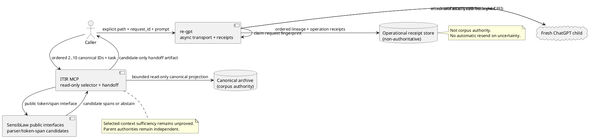

# Governed revival and canonical handoff — max-cut working notes

FORMAL MODEL: O, R, C, S, L, P, G, F

- O (Organization): ITIR MCP exposes evidence and governance; canonical archive is corpus authority; SensibLaw owns token/PNF parsing; AO owns lifecycle decisions; re-gpt owns async mutation.
- R (RFP): revive a predecessor through canonical graph evidence, task/proof-gap/repo receipts, bounded handoff and explicit operation disposition.
- C (Code): ITIR `pnf_work_packet_provider`, `pnf_tools`, `registry`, `server`, `autonomous_orchestrator_tools`, `scripts/autonomous_fleet_daemon.py`; SensibLaw `shared_reducer`, `deterministic_legal_tokenizer`, `residual_lattice`; Dashi `audit_pnf_numeric_abi_surface.py`.
- S (State): parent canonical thread, candidate successor, source message/node parent pointers, explicit operation status and receipt.
- L (Lattice): parsed token evidence is weaker than reviewed typed PNF, which is weaker than kernel/formal proof; contradiction and missing receipts block promotion.
- P (Proposal): task atom, formal-gap/repo/PNF receipts, compact source span refs and derived candidates.
- G (Governance): reference-only inspection; no dispatch, no browser/DOM, no retry of commit-unknown operations.
- F (Gap): unresolved formal obligation and parser/proof receipt difference; lexical signals never close the gap.

## Inspected repository evidence

- ITIR-suite `ROADMAP.md` and `docs/planning/canonical_candidate_ledger_v1.md` prescribe structured canonical corpus and evidence-first admit/merge/park/retire.
- `scripts/autonomous_fleet_daemon.py` still queries `~/.chatgpt_history.sqlite3`, uses title-derived prompts, and includes an unsafe DOM fallback after retries. This cut does not call that daemon.
- `itir_mcp.pnf_work_packet_provider` already provides bounded canonical references, but tail-only selection can omit earlier proof decisions; it currently emits lexical hints only.
- `itir_mcp.autonomous_orchestrator_tools` supplies status/claim/heartbeat/report governance, not a canonical handoff view.
- SensibLaw `docs/pnf_itir_primer.md` explicitly prohibits promoting regex matches to semantic PNF authority; `src.text.deterministic_legal_tokenizer.tokenize_with_spans` exposes span offsets.
- Dashi `scripts/audit_pnf_numeric_abi_surface.py` maps Python ABI to Agda but does not certify revival safety; formal gap recorded below.

## Contract

New read-only MCP tools must expose (1) bounded canonical thread view and (2) task-aware predecessor→child handoff with provenance and explicit operation gating. Scan **all messages** in the selected thread via streaming cursor to find evidence across the full timeline, not the first 30,000 characters; retain a recent-tail anchor and high-value task matches, subject to hard budgets. Never serialize raw message bodies. Preserve `parent_node_id`, `node_id`, `branch_membership` and source locator/digest. PNF tokens, if SensibLaw is importable, are source-linked lexical evidence, not typed proof; if unavailable, abstain explicitly. Do not write canonical messages or invoke re-gpt mutation. No automatic resend of `async_starting`/`commit_unknown`.

## TODO

- [x] Implement full-span, bounded selection with deterministic receipts and explicit truncation.
- [x] Expose read/view/operation-review MCP surfaces without raw SQLite.
- [x] Add fixture tests for lineage, tail decision preservation, ambiguity gate, budgets and registry (execution pending).
- [x] Record local execution boundary, formalisation gap and next phase.

## Delivered — reference-only canonical handoff slice

- `itir_mcp.governed_revival.governed_handoff` streams the **entire** canonical predecessor in chronological order (hard scan ceiling one million rows), ranks bounded task/proof signals and retains the last two messages regardless of score. This replaces a first-30,000-character cut with a full-timeline scan and bounded selected output, not unbounded transcript copying.
- Canonical source refs include `message_id`, `source_message_id`, `source_thread_id`, `node_id`, `parent_node_id`, `branch_membership`, timestamp, role, digest and SQLite locator. No source text leaves the archive.
- SensibLaw's `tokenize_with_spans` is used when available at the suite-relative `SensibLaw` location. A bounded regex fallback is explicitly labeled `regex_hint_only`; both routes abstain from claiming typed semantic PNF. The existing SLR world-store/typed predicate reducer is **not yet wired**, and is not silently emulated.
- A deterministic packet ID, task and proof-gap receipt refs, explicit full-scan/selection/truncation receipt, parent→proposed-child lineage receipt, and ambiguity-aware governance decision are returned.
- Registered read-only MCP tools: `itir.pnf.governed_handoff`, `itir.archive.thread_view`, `itir.ao.operation_review`. They follow the existing ToolSpec/registry and FastMCP wrapper; the archive is read via `mode=ro`.
- `itir.ao.operation_review` treats `async_starting` and `commit_unknown` as `hold_reconcile_no_resend`, and **never** authorizes dispatch. It reviews supplied operation state; it does not read or modify a live operation ledger.
- Authority separation: canonical archive (source), legacy history cache (excluded), lexical/PNF projection (candidate), reviewed controversy (receipt only), formal evidence (receipt only), UI (projection only).

### Exact local verification commands

```bash
python -m unittest discover -s tests -p 'test_governed_revival_handoff.py' -v
python -m unittest discover -s tests -p 'test_pnf_work_packet_provider.py' -v
ruff check itir-mcp/src/itir_mcp/governed_revival.py itir-mcp/src/itir_mcp/pnf_tools.py tests/test_governed_revival_handoff.py
PYTHONPATH=itir-mcp/src python -c 'from itir_mcp.registry import build_default_registry; print([t.name for t in build_default_registry().list_tools() if t.name in ("itir.pnf.governed_handoff", "itir.archive.thread_view", "itir.ao.operation_review")])'
```

**Execution status:** these commands have **not** been run on a local checkout; GitHub access is connector-only and direct git clone fails DNS resolution. No CI/Colab or Agda kernel verification was run. The test file contains four offline fixture cases, but green status is not claimed.

### Formalisation gap (explicit)

Existing Dashi Agda PNF/numeric ABI surfaces and SensibLaw residual lattice do **not** establish a proof that a selected canonical message set is sufficient for revival or that a candidate is authorized. Required future theorem: for a canonical graph `H`, selector `S(H,task)`, handoff `P`, and authorization predicate `Auth`, prove (i) every selected reference resolves to a node in `H` with equal digest and parent pointer, (ii) `Auth(P)=false` absent explicit review, (iii) an ambiguous operation receipt entails `¬Resend`, and (iv) omitted evidence is reported as a residual rather than interpreted as absence. This is a **formal obligation**, not an Agda/Lean checked theorem.

### Remaining blockers / next phase

1. Wire the producer-owned SLR parser, typed `PredicatePNF` reducer and durable world-store to the selected spans, with exact parser/ontology version receipts. Lexical span candidates are not semantic evidence.
2. Build an authenticated, durable operation-status reader and explicit approval/reconciliation workflow; supplied operation status is not independently verified.
3. Integrate this handoff with a replacement for the legacy fleet daemon. **Do not run the old daemon as a governed revival controller**: it still uses the transport cache, title-derived prompts, and contains a DOM fallback. The new read-only MCP path does not call it.
4. Provide source-span completeness and privacy review policies, branch-aware chronology semantics, durable handoff/parent-child operation receipts, and Agda/Lean invariant proof.
5. Verify on the production MCP stdio transport and canonical archive under AO/referee control. No mutation, dispatch, browser, CI or PG work was performed in this cut.

## Delivery and verification boundary (2026-10-20)

The branch implements `itir.pnf.governed_handoff`, `itir.archive.thread_view`, and `itir.ao.operation_review` through the existing MCP registry. `governed_revival.py` reads canonical SQLite in read-only mode, scans the selected thread across its entire timeline (hard ceiling one million rows), keeps task-ranked evidence plus two latest messages, retains source digests, message/node parent pointers, branch membership and source span offsets. The output is a candidate projection; no raw body is returned or duplicated.

`tests/test_governed_revival_handoff.py` supplies a 90-message production-column fixture and four test cases covering early and late decisions, provenance and lineage, ambiguous async operation holds, packet bounds, registry and tool invocation.

**Local verification not completed.** This GitHub-connector session does not have a mounted ITIR-suite checkout; a direct `git ls-remote https://github.com/chboishabba/ITIR-suite.git refs/heads/chatgpt/governed-revival-handoff-v1` attempt in the execution container failed with `Could not resolve host: github.com`. The connector can fetch/edit repository files but cannot execute the local project environment. No test, Ruff, Agda/Lean or live archive success is asserted; no GitHub Actions or CI was run.

Referee commands (from the ITIR-suite checkout):
```bash
python -m unittest discover -s tests -p 'test_governed_revival_handoff.py' -v
ruff check itir-mcp/src/itir_mcp/governed_revival.py itir-mcp/src/itir_mcp/pnf_tools.py tests/test_governed_revival_handoff.py
(cd itir-mcp && PYTHONPATH=src python -c "from itir_mcp.registry import build_default_registry; print([s.name for s in build_default_registry().list_tools() if 'handoff' in s.name or 'thread_view' in s.name or 'operation_review' in s.name])")
```

**Acceptance boundary:** a successful fixture run is not a production proof. Next require a real canonical archive smoke call, a genuine SensibLaw tokenizer/SLR PNF selected-span producer receipt, an AO lineage receipt with actual successor thread ID, and exact-head Agda/Lean formal checks. The current token-span candidates are explicitly `semantic_pnf: abstained`; typed PNF/world-store compilation and proof discharge are **not** implemented in this cut. No claim of formal closure, no automatic operation dispatch or retry. Formalisation gap: establish an Agda/Lean theorem that a read-only handoff preserves the canonical node/parent lineage, does not promote candidate evidence, and cannot authorize resend of ambiguous operations.

## Review corrections — public parser and operation receipt lookup

**Public SensibLaw contract:** `itir_mcp.governed_revival` imports only `sensiblaw.interfaces.shared_reducer.tokenize_canonical_with_spans`, from the explicit suite-relative producer root. It never imports the private `src.text.deterministic_legal_tokenizer`. If the public interface is unavailable, candidate spans are empty, `producer_receipt.available=false`, and `fallback=abstain_no_parser_authority`; no regex-derived semantic candidates or alternative parser authority are invented. Public token offsets remain lexical candidates, not typed PNF/proof closure.

**MCP-owned receipt lookup:** `itir.chatgpt.operation_receipts` takes a canonical thread ID, resolves exactly one `source_thread_id` through read-only canonical `messages`, and reads only bounded `mutation_attempts` fields from the separate re-gpt transport receipt SQLite database (`db_path`, `ITIR_REGPT_RECEIPT_DB`, or `~/.chatgpt_history.sqlite3`). It returns latest/active receipt IDs, state, node references, prompt digest, timestamps, transport and per-operation `itir.ao.operation_review` decisions. It never returns prompt bodies, error details, attachments or transcript text; `LIMIT limit+1` yields explicit `more_available`. Missing/ambiguous canonical→transport identity and absent/mismatched receipt schema fail closed. Transport receipts are **not** canonical corpus authority. `async_starting`/`commit_unknown` remain hold/no-resend. No browser, DOM, dispatch or reconciliation mutation is invoked.

Canonical ZKP model remains O, R=RFP, C, S, L, P, G=governance, F=gap function; G is not collapsed into F.

**Intended referee verification only — not executed in this connector session:**
```bash
python -m unittest discover -s tests -p 'test_governed_revival_handoff.py' -v
ruff check itir-mcp/src/itir_mcp/governed_revival.py itir-mcp/src/itir_mcp/operation_receipt_lookup.py itir-mcp/src/itir_mcp/chatgpt_worker_tools.py itir-mcp/src/itir_mcp/pnf_tools.py tests/test_governed_revival_handoff.py
(cd itir-mcp && PYTHONPATH=src python -c "from itir_mcp.registry import build_default_registry; print([t.name for t in build_default_registry().list_tools() if 'operation_receipts' in t.name or 'governed_handoff' in t.name])")
```

Residual: real-host stdio MCP smoke, canonical ID mapping across multi-source threads, public SensibLaw producer installation, and kernel-verified typed PNF/world-store proof remain referee/next-phase boundaries.


## Multi-parent revival extension (2026-10-31)

The feat/governed-multi-parent-revival-v1 implementation adds an explicit
2–10-parent path without changing the one-parent itir.chatgpt.revive /
chatgpt_revive compatibility path.

### Read-only candidate construction

- itir.pnf.multi_parent_handoff accepts 2–10 distinct canonical_thread_id +
  task_atom proposals and reads only the canonical archive schema
  (canonical_thread_id plus canonical graph/source columns).
- The previous compressed re-gpt transcript-schema fallback has been removed
  from governed handoff selection. An operational transcript database is not
  accepted as corpus authority.
- Task and source token spans are obtained only from the public
  sensiblaw.interfaces.shared_reducer.tokenize_canonical_with_spans interface.
  If that producer is unavailable, token selection abstains; no regex
  tokenizer, English predicate list, direct spaCy, or private src.* import is
  substituted.
- Each parent remains a separate projection with its own source refs, digest
  packet and omission receipt. The candidate world is a bounded union of
  references/candidate spans only. There is no cross-parent deduplication,
  equivalence, contradiction resolution, reviewed-world promotion or proof.
- The read-only projection returns references and candidate offsets, not raw
  transcript bodies. It does not mutate the canonical archive.

### Fresh-child attachment and lineage

1. Call itir.pnf.multi_parent_handoff for the chosen 2–10 canonical parents.
2. Persist the returned candidate packet at an explicit, caller-owned
   handoff_path. Do not substitute an operational transcript export.
3. Call itir.chatgpt.revive_multi with the same ordered canonical parent IDs,
   that explicit artifact path, the continuation prompt and a stable caller-supplied
   request_id. Repeating the same request_id/payload returns the stored receipt;
   reusing the key for a different payload is rejected.
4. The re-gpt adapter creates one fresh conversation over direct async CFFI,
   then attaches the artifact exactly once. The attachment is accepted only
   through the existing MutationService canonical attachment binding receipt.
5. Ordered parent edges, handoff digest/path and attachment operation/state are
   durably recorded in the re-gpt operational lineage-receipt tables. This is
   adapter/operation evidence only; it is not a second corpus authority.

A creation result in commit_unknown does not proceed to attachment. An
ambiguous attachment result is recorded and is never automatically resent.
The parent conversations remain untouched and independently authoritative.
The existing single-parent revival entrypoint remains available unchanged.

### Exact intended verification

From the ITIR-suite root:

    python -m unittest discover -s tests -p 'test_governed_revival_handoff.py' -v
    python -m unittest discover -s tests -p 'test_multi_parent_revival.py' -v
    python -m unittest discover -s tests -p 'test_multi_parent_revival_tool.py' -v
    ruff check itir-mcp/src/itir_mcp/governed_revival.py itir-mcp/src/itir_mcp/pnf_tools.py itir-mcp/src/itir_mcp/chatgpt_worker_tools.py itir-mcp/src/itir_mcp/multi_parent_revival_tools.py itir-mcp/src/itir_mcp/registry.py tests/test_governed_revival_handoff.py tests/test_multi_parent_revival.py tests/test_multi_parent_revival_tool.py
    (cd itir-mcp && PYTHONPATH=src python -c 'from itir_mcp.registry import build_default_registry; print([t.name for t in build_default_registry().list_tools() if "multi_parent" in t.name or "revive_multi" in t.name])')

From the reverse-engineered-chatgpt root:

    pytest -q tests/test_multi_parent_revival.py
    ruff check re_gpt/multi_parent_revival.py re_gpt/mcp_server.py tests/test_multi_parent_revival.py

These commands are intended referee checks; they have not been executed in
this GitHub-connector session.

### Residual formal and product gaps

- Selected-context sufficiency for any revival task remains UNPROVED.
  formal_gap.selected_context_sufficiency_proved is explicitly false.
- This first multi-parent artifact is a reference/candidate packet, not a
  complete typed SensibLaw world-store compilation. A future producer-owned
  compiler may enrich it only with versioned parser/PNF receipts and without
  collapsing the candidate/review/proof lattice.
- No theorem establishes that omitted source messages are irrelevant, that
  two parent statements are equivalent, or that the child is a complete
  continuation of all parent tasks.
- Real-host MCP stdio, owned-session attachment, canonical archive mapping and
  exact-head tests remain operator verification requirements. No live ChatGPT
  mutation or attachment was performed by this implementation session.


## DASHI formal correspondence and ZKP contract

The implementation reuses existing golden Agda machinery. It does not introduce a
revival-specific equivalence theorem or claim that the workflow itself is proved.

### O / R / C / S / L / P / G / F

- **O — Organization:** the canonical archive is the only corpus authority.
  ITIR owns read-only selection and candidate handoff construction. re-gpt owns
  transport and operation/lineage receipts. The MCP registry owns guarded tool
  contracts. Parent conversations remain independent authorities.
- **R — Requirement:** accept 2–10 distinct, ordered canonical parent IDs;
  produce a bounded candidate-only handoff; attach it once to one fresh child;
  preserve the legacy one-parent API.
- **C — Code:** canonical archive schema only; public
  `sensiblaw.interfaces.shared_reducer.tokenize_canonical_with_spans` only.
  Missing parser authority means abstention. No operational transcript fallback,
  regex semantic extraction, hand-authored predicate list, direct spaCy, or
  private `src.*` import.
- **S — State:** a caller-owned artifact path and stable request ID are explicit.
  The request fingerprint binds ordered parents, artifact digest and prompt
  digest. An identical replay returns the existing receipt; key reuse with a
  different fingerprint is rejected.
- **L — Logic:** raw source references precede lexical/parser candidates;
  candidates precede reviewed world models; reviewed models precede formal
  proof. No stage is skipped. A shared candidate does not establish identity,
  equivalence, contradiction, truth, or theoremhood.
- **P — Proof obligations:** preconditions, invariants and postconditions below.
  Only the generic candidate/residual propositions listed in the Agda mapping
  are currently kernel-checked. The end-to-end revival theorem is not.
- **G — Governance:** read-only projections do not dispatch or mutate source
  conversations. A fresh-child write and attachment require the explicit
  caller request. Never retry or resend an uncertain operation. Lineage rows
  are transport receipts, not corpus authority.
- **F — Formal gap:** selected-context sufficiency remains open. The packet
  does not prove that omitted messages are irrelevant or that the child
  continues every parent task.

### Preconditions, invariants and postconditions

Let (P=[p_0,\ldots,p_{n-1}]) be the ordered parent list, (H) the
explicit handoff bytes, (r) the caller request ID, and (c) the new child.

**Preconditions**

1. (2 \leq n \leq 10); every (p_i) is a non-empty canonical ID and
   the IDs are pairwise distinct.
2. Every parent projection resolves against the canonical archive schema.
   No re-gpt operational transcript database is a fallback corpus.
3. (H) is a bounded, versioned candidate-only artifact whose ordered parent
   IDs equal (P), whose source-content materialization flag is false, whose
   cross-parent equivalence set is empty, and whose sufficiency-proof flag is
   false.
4. (r) is non-empty and stable for this logical operation. The artifact path
   is explicit and caller-owned.
5. If the public SensibLaw token-span producer is unavailable, lexical
   selection abstains rather than substituting another semantic extractor.

**Invariants**

1. Parent order and identity are preserved in each projection and in durable
   lineage edges. No parent is merged, rewritten, retired or treated as a
   child of another parent.
2. Candidate output carries no truth, support, admissibility, runtime or
   theorem authority and is never silently promoted.
3. The request key is claimed before the first remote write. A matching replay
   cannot dispatch again; a mismatching payload under the same key is rejected.
4. A creation state of `commit_unknown` blocks attachment. Any uncertain
   attachment is retained as an operation receipt and is never automatically
   resent.
5. The archive remains corpus authority; re-gpt SQLite stores only operation
   and lineage receipts. No raw transcript body is included in the handoff.

**Postconditions**

- On a confirmed success: exactly one fresh child exists, one explicit
  attachment operation has a MutationService-owned receipt, and the ordered
  parent edges plus artifact digest/path are recorded.
- On a confirmed creation failure or uncertain creation: no attachment is
  dispatched.
- On an uncertain attachment: the uncertain state and operation ID are
  retained; replay returns the receipt without redispatch.
- In every outcome: parent authorities remain independent and
  `selected_context_sufficiency_proved = false`.

### Existing golden Agda machinery

The following modules are reused as the semantic authority. Their generic
lemmas constrain the implementation; they do **not** prove the whole
multi-parent protocol.

| Agda owner | Existing proposition/construct | Revival interpretation |
|---|---|---|
| `DASHI/Core/CandidateOnlyCore.agda` | `CandidateOnlyReceipt`: candidate-only is true, promoted is false, and truth/support/admissibility/trading/runtime/theorem authority bits are false | A handoff candidate cannot be promoted by packaging or transport |
| `DASHI/Interop/PNFPackageCore.agda` | typed package and fail-closed package obligations | Missing or invalid typed evidence must remain unavailable/abstained |
| `DASHI/Cognition/PNF/EventAlgebra.agda` | `CandidatePNF`, retained alternatives, `ComparisonResult`, `noTypedMeet`, receipt-bearing composition and revisions | Similarity is not equivalence; preserve alternatives and typed residuals |
| `DASHI/Interop/ResidualBoundaryCore.agda` | exact/partial/no-typed-meet/contradiction residual boundary | Incomparable parent evidence is not automatically contradictory |
| `DASHI/Interop/InspectionRelativeNoTypedMeet.agda` | inspection-relative no-typed-meet and bridge-revisability | Absence of a typed meet is a scoped residual, not a global impossibility |

In particular, `noTypedMeet` is distinct from contradiction. The revival
adapter must preserve that distinction and must not collapse incomparable
parent candidates into one normalized fact.

### Lean consumer status

The checked-in `dashi_lean4` README and
`docs/DECLARATION_LANDSCAPE.md` currently describe the small DashiPerf
surface and bundle-name inventory. Code search did not find checked-in Lean
counterparts for the candidate-only/PNF residual declarations above. Therefore
this cut adds no Lean theorem and claims no Lean verification of the revival
protocol. Agda remains golden; a Lean consumer must be added only when the
actual checked-in Agda declarations and proof obligations can be translated
without strengthening them.

### Normalized control and architecture view

The following is a traceability aid, not a claim of certification against any
standard:

- ITIL: explicit service boundary, operation state, ownership and incident
  handling for ambiguous writes.
- ISO 9000 / Six Sigma: versioned acceptance criteria, reproducible fixtures,
  deterministic failure states and traceable corrective actions.
- ISO/IEC 42001, 23894 and NIST AI RMF: documented authority limits,
  uncertainty, abstention, human review boundary and residual risk.
- ISO/IEC 27001 and 27701: least privilege, read-only source projection,
  data minimization, explicit artifact path and bounded receipts.
- ISO 9241: stable public tool contract, explicit required fields and
  predictable error/abstention behavior.
- C4/PlantUML: ownership is separated by component; data and mutation flow
  are explicit.



### Deterministic referee commands

From the reverse-engineered-chatgpt checkout, with its declared project
dependencies installed:

```bash
pytest -q tests/test_multi_parent_revival.py tests/test_multi_parent_mcp_contract.py
ruff check re_gpt/multi_parent_revival.py re_gpt/mcp_server.py tests/test_multi_parent_revival.py tests/test_multi_parent_mcp_contract.py
```

The public-entrypoint contract test imports the native MCP server, asserts
that `request_id` has no default, invokes `chatgpt_revive_multi`, and checks
that the stable key is forwarded unchanged to `revive_from_handoff`.

From an ITIR workspace that also has the sibling re-gpt package and MCP
runtime installed (the isolated worktree alone is insufficient):

```bash
python -m unittest discover -s tests -p 'test_multi_parent_revival_tool.py' -v
python -m unittest discover -s tests -p 'test_multi_parent_revival.py' -v
(cd itir-mcp && PYTHONPATH=src python -c 'from itir_mcp.registry import build_default_registry; s={t.name:t for t in build_default_registry().list_tools()}; assert "itir.chatgpt.revive_multi" in s; assert not s["itir.chatgpt.revive_multi"].read_only')
```

If the ITIR isolated worktree reports `ModuleNotFoundError: re_gpt`, make the
sibling checkout importable using the workspace's normal editable-install or
`PYTHONPATH` setup. If it reports `ModuleNotFoundError: mcp`, install the
declared ITIR MCP runtime dependencies before running the registry test. These
are environment prerequisites, not passing tests; report them rather than
masking them.

Agda referee (from the dashi_agda checkout):

```bash
agda -i . DASHI/Core/CandidateOnlyCore.agda
agda -i . DASHI/Interop/PNFPackageCore.agda
agda -i . DASHI/Cognition/PNF/EventAlgebra.agda
agda -i . DASHI/Interop/ResidualBoundaryCore.agda
agda -i . DASHI/Interop/InspectionRelativeNoTypedMeet.agda
```

No Lean command is prescribed for this cut because the checked-in Lean
repository currently has no matching declarations to compile. Do not treat a
name-only bundle reference as a checked-in Lean theorem.
